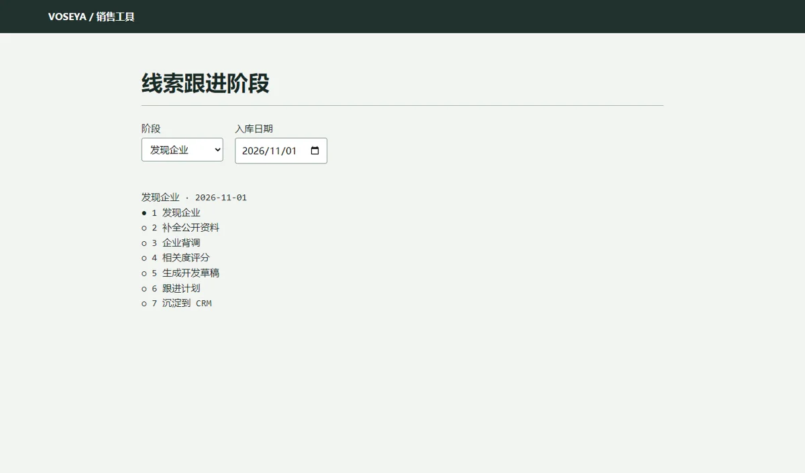
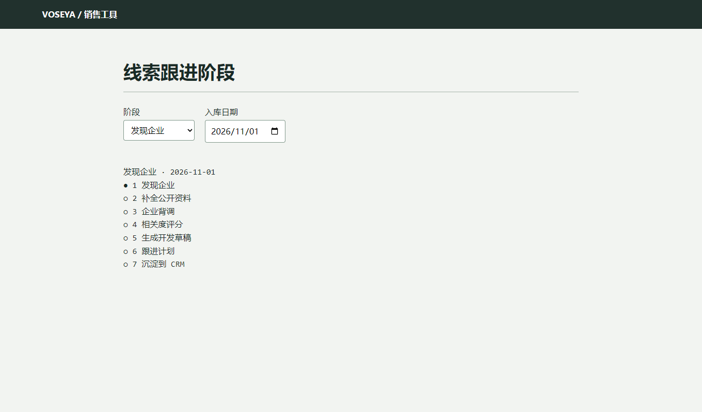
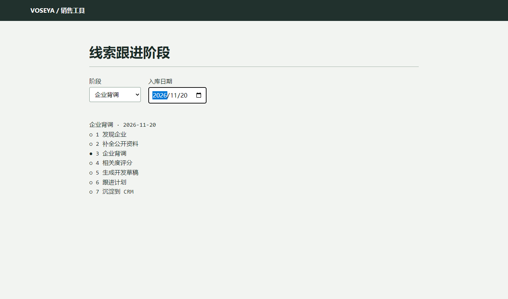

# VOSEYA 线索流程组件

获客平台中的原生跟进阶段与时间处理拆为独立模块，供本地 CRM 展示、排序及保留入库时间。

## 实际界面巡览



上图由两张本次实际运行画面的截屏轮换组成，不是连续操作录像。

| 初始线索阶段 | 切换阶段与日期 |
| --- | --- |
|  |  |

## 可以做什么

- 从发现企业走到草稿和跟进
- 区分日期、时间点和未知值
- 使用合成记录查看阶段变化，不读客户库

## 本地运行

```sh
python -m http.server 8000 --bind 127.0.0.1
```

在浏览器打开 `http://127.0.0.1:8000/`。只监听本机；不执行部署。

## 实测与范围

手动改变跟进阶段和日期，页面按原业务模块重新计算。

不是 VOSEYA 品牌官网或整套销售平台的开源副本；未接通正式账户、客户名录、邮件或自动获客。

[手机宽度实机截屏（390 px）](showcase/03-mobile.png) · [授权范围](LICENSE) · [来源与署名](NOTICE.md)
